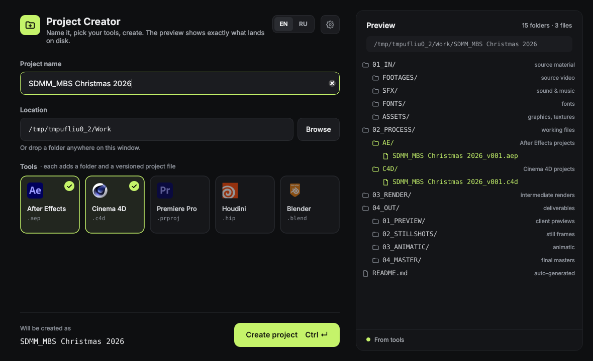
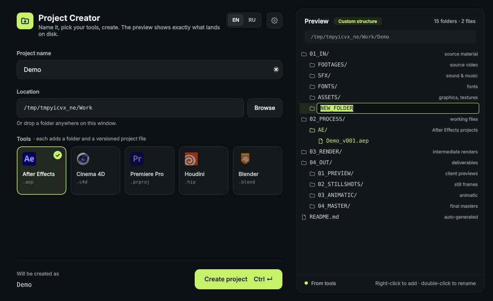

# Project Creator 1.1

A small desktop app that creates a clean, consistent folder structure for motion design and video projects, with ready-to-open project files for After Effects, Cinema 4D, Premiere Pro, Houdini and Blender.



- Live preview of exactly what will be created
- One click (or Ctrl+Enter) creates the folders, a `README.md`, and versioned template files such as `MyProject_v001.aep`
- Edit the folder structure right in the preview — rename, add, delete, undo — and it's remembered
- English and Russian interface

## Run it

Double-click **`launcher.bat`**. On first run it installs PySide6 (Qt 6), then opens the app.

Or from a terminal:

```bash
pip install -r requirements.txt
python main.py
```

Requires Python 3.10+.

To build a standalone `.exe`, run **`build_exe.bat`** — the result is `dist\ProjectCreator\ProjectCreator.exe`.

## Using it

1. Type a project name. Characters Windows doesn't allow (`< > : " / \ | ? *`) are removed, and the final folder name is shown above the Create button.
2. Pick a location — Browse, type a path, or drop a folder onto the window.
3. Toggle the tools you'll use. Each adds `02_PROCESS/<TOOL>/` with a copy of its template named `<Project>_v001.<ext>`.
4. Press **Create project** or **Ctrl+Enter**.

The preview on the right is built from the same definition the app writes to disk, so what you see is exactly what you get. A `README.md` describing the structure is added to every project.

## Editing the structure

Edit the folders right in the preview:



| Action | How |
|---|---|
| Rename a folder | Double-click it, or select it and press **F2** |
| Add a folder | Right-click a folder → **New subfolder** (inside) or **New folder** (next to it). Right-click empty space to add at the top level |
| Delete a folder | Right-click → **Delete**, or select it and press **Del** |
| Undo | **Ctrl+Z** (with the preview focused) or right-click → **Undo** |
| Back to default | Right-click → **Reset to default structure** |

New top-level folders continue the numbering (`05_NEW_FOLDER`). Names are cleaned of characters Windows doesn't allow, and duplicate names in the same folder are refused.

Your structure is saved and used for every new project until you reset it — a **Custom structure** badge shows when it differs from the default. Tool folders (green) come from the tool tiles, so toggle a tile to add or remove them; `02_PROCESS` can be renamed but not deleted, because tool folders go there.

## Structure

```
<Project>/
├── 01_IN/            source material
│   ├── FOOTAGES/
│   ├── SFX/
│   ├── FONTS/
│   └── ASSETS/
├── 02_PROCESS/       working files
│   ├── AE/           <Project>_v001.aep      (if After Effects is selected)
│   ├── C4D/          <Project>_v001.c4d      (if Cinema 4D is selected)
│   ├── PR/  HOUDINI/  BLENDER/               (same pattern)
├── 03_RENDER/        intermediate renders
├── 04_OUT/           deliverables
│   ├── 01_PREVIEW/
│   ├── 02_STILLSHOTS/
│   ├── 03_ANIMATIC/
│   └── 04_MASTER/
└── README.md
```

This is the default; change it in the preview (see above). The default itself and the tool list live in `app/structure.py`.

## Templates

Templates live in `resources/templates/`. The first file with the matching extension is used (`template.aep`, `template.c4d`, …), so you can replace any of them with your own start scene.

## Settings

Stored per user in `%APPDATA%\ProjectCreator\settings.json`: default projects folder, language (EN/RU), your custom folder structure, the last tools you used, and window position.

## Code layout

```
main.py                    entry point
app/structure.py           folder layout + tools (single source of truth)
app/creator.py             writes a project to disk, renders README (no Qt)
app/settings.py            JSON settings in AppData
app/i18n.py                English and Russian strings
app/paths.py               resources, app data, open in Explorer
app/ui/theme.py            colors, fonts, stylesheet, dark title bar
app/ui/widgets.py          tool tiles, preview tree, banner, segmented control
app/ui/main_window.py      the main screen
app/ui/settings_dialog.py  settings
```

## Changes in 1.1

- Edit the folder structure in the preview: rename (double-click / F2), add (right-click), delete (Del), undo (Ctrl+Z), reset. Saved between sessions.

## Changes in 1.0 (from 0.3)

- Rebuilt on PySide6 / Qt 6: native high-DPI scaling replaces the custom adaptive-scaling code.
- New single-screen layout with a live preview; results show inline instead of in a popup.
- Template files are versioned: `<Project>_v001.<ext>`.
- One structure definition drives preview, folders and README (previously three separate copies).
- Project creation is instant (the artificial progress delays are gone) and rolls back cleanly if something fails.
- Live validation: invalid characters, existing folder, missing location.
- Full English/Russian translation, switchable instantly from the header.
- Settings moved to AppData; icons and templates load correctly from a built `.exe`.

---

Remit Otkin · [GitHub](https://github.com/RemitOtkin)
